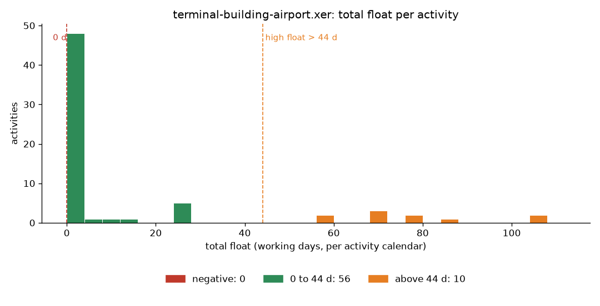
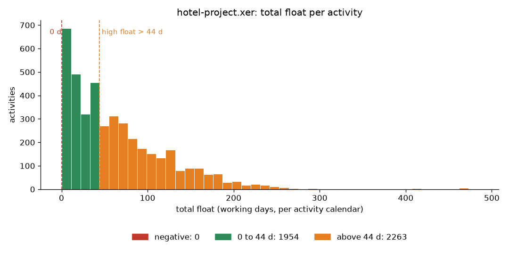

# p6checker

A small checker for Primavera P6 `.xer` schedule exports. It reads the file,
quarantines rows it cannot trust, runs three schedule-health checks and draws
one chart. Built in about two hours as a take-home exercise.

```
pip install -e ".[dev]"
p6check data/*.xer --out reports
pytest
```

`p6check` prints a summary per file and writes `reports/<file>.html` (self-contained,
chart embedded), `.png` (the chart) and `.json` (every finding and every broken row).

## The two schedules

Both are real P6 exports (Windows-1252 encoded, XER 5.0 and 6.0), taken from the
MIT-licensed [CodeVision3000/P6-Viewer](https://github.com/CodeVision3000/P6-Viewer)
sample set.

| file | projects | activities | relationships | source |
|---|---|---|---|---|
| `data/terminal-building-airport.xer` | 1 | 66 | 84 | airport terminal building, 2012 |
| `data/hotel-project.xer` | 4 | 4,236 | 7,586 | hotel programme (design, procurement, construction, handover), 2013 |

## Results

| check | airport | hotel |
|---|---|---|
| broken rows quarantined | 0 | 0 |
| missing links (no predecessor and/or no successor) | 2 | 27 |
| negative float | 0 | 0 |
| high float (above 44 working days) | 10 | 2,263 |
| activities with no float value (never scheduled) | 0 | 19 |

Airport: the two open ends are the project start milestone (no predecessor) and
the finish milestone (no successor), which is exactly what a closed network should
look like. Ten activities carry 59 to 107 days of float.

Hotel: more than half of the activities (2,263 of 4,217 scheduled) sit above the
44-day threshold, with a long tail out to 472 days. That is normally a sign that
the programme is scheduled against a far-off finish date, or that large parts of
the network are only loosely tied to the driving path. Of the 27 open-ended
activities, 19 are construction (CR) activities with neither predecessors nor
successors, 7 are finish milestones with no successor, and 1 has no predecessor.




The numbers in the table were cross-checked with a separate throwaway script that
reads the raw tab-separated text directly, without the parser; both agree.

## What counts as a broken row

An XER file is tab-separated text: `ERMHDR` header, then `%T table`, `%F fields`,
`%R row…`, `%E`. The parser never guesses. A row goes into the quarantine list,
with its line number and a reason, and is excluded from every check when it is:

- a `%R` with a different number of values than the table's `%F` line
- a `%R` or `%F` before any `%T`, or a line with an unknown record type
- data after the `%E` end marker
- a `TASK` row missing `task_id`, `task_code`, `task_type` or `status_code`
- a `TASK` row whose float is not a number, or whose dates are not `YYYY-MM-DD HH:MM`
- a `TASK` row that reuses a `task_id` already seen
- a `TASKPRED` relationship pointing at an activity that does not exist

A file that is not an XER at all (no `ERMHDR`, empty, undecodable) is rejected
with a clear error instead of producing an empty report.

Neither public file has a single broken row, so `tests/fixtures/planted-defects.xer`
is a hand-written file with one of each defect above. Run it to see the quarantine
in action:

```
p6check tests/fixtures/planted-defects.xer
```

## The three checks

Float is stored in the file in hours. It is converted to working days with the
activity's own calendar (`CALENDAR.day_hr_cnt`), falling back to 8 h/day, so
activities on 8-hour and 10-hour calendars are compared fairly.

- **Missing links.** An activity with no predecessor, no successor, or neither.
  Level-of-effort and WBS-summary activities are skipped because they do not
  carry logic. Milestones are included; a healthy network has exactly one open
  start and one open finish.
- **Negative float.** Total float below zero: the activity is already late against
  a constraint or a must-finish date.
- **High float.** Total float above 44 working days (the DCMA 14-point assessment
  threshold). The threshold is a flag: `--high-float-days 30`.

The chart is the distribution of total float per activity, with the same two
thresholds drawn on it, so the chart and the finding counts always agree.

## Layout

```
p6checker/parser.py   XER reader, encoding detection, broken-row quarantine
p6checker/checks.py   the three checks, hours-to-days conversion
p6checker/chart.py    float histogram (matplotlib)
p6checker/report.py   terminal summary, HTML and JSON output
p6checker/cli.py      p6check command
tests/                15 tests: parser edge cases, each check, the real files, CLI
```

No dependencies beyond matplotlib. Python 3.10+.

## What I would do next

- Compute float per project in multi-project files like the hotel one, since P6
  schedules each project against its own must-finish date.
- Add the rest of the DCMA 14-point checks (leads, lags, hard constraints,
  relationship types, invalid dates) on the same parser.
- Load the parsed tables into Postgres instead of holding them in memory, so
  monthly updates of the same project can be compared.
